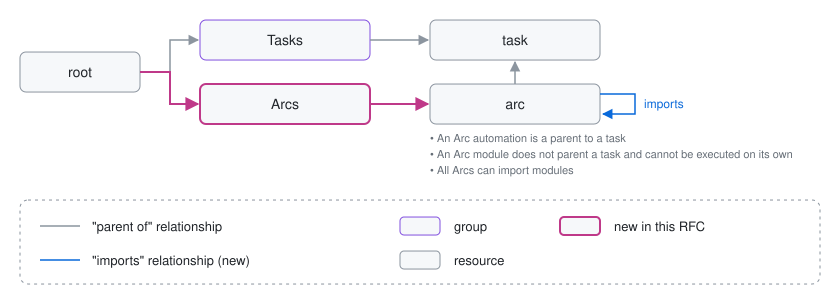
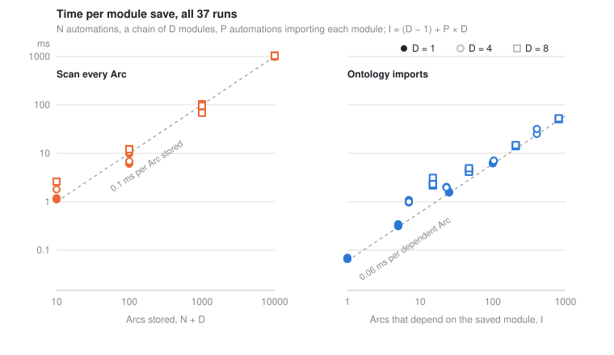

# 82 Arc user modules

- **Author**: Nico Alba
- **Date**: 2026-10-21
- **Related**: [RFC 0005 - MVP - Data ontology](0005-ontology.md),
  [RFC 0030 - Arc module system](0030-arc-modules.md),
  [RFC 0056 - Task autosave with deploy-on-start](0056-task-autosave-deploy-on-start.md)

## 0 Summary

An Arc is either an automation or a module. A module exports code that other Arcs import
by path, and the path is the module's position in the ontology below an "Arcs" group. A
module save finds its importers from their import statements and makes their tasks
drift. This RFC covers the implementation, not the rendering.

## 1 Motivation

Users need to write a function or sequence once and import it from many automations. Arc
resolves only standard modules today (RFC 0030 §5), so an automation engineer who writes
a shutdown sequence or a conversion function pastes it into each automation that needs
it.

## 2 Vocabulary

- **Automation**: An Arc with `type = automation`. It binds to a rack and is the parent
  of its task.
- **Module**: An Arc with `type = module`. It has no rack and no task.
- **Path**: The group names below "Arcs", then the Arc's own name, joined by `.`. A
  module's path is its import name.
- **Importer**: An Arc whose text imports a module, directly or through another module.

## 3 Design

### 3.0 Arc type

An Arc carries `type`, `automation` or `module`, chosen at creation and never changed.
Binding a rack to a module is a validation error, and so is importing an automation.

### 3.1 The Arcs group



- **Root group**: The Arc service creates "Arcs" below the ontology root with
  `group.Service.CreateOrRetrieve`, as the channel, task, and project services do, and
  parents every new Arc under it.
- **Directories**: A group below "Arcs" is a directory. A module may sit directly under
  "Arcs" or in a group at any depth (§5.0, §5.1).
- **Names**: Group and module names are validated like channel names.
- **Resolution**: A path walks `parent_of` down from "Arcs", one segment per level, and
  matches the last segment against a module's name. An import binds the last segment:

```arc
import (
    sy_lib.m1
    sy_lib.sub_group.m3
    m4 // directly under "Arcs"
)

true => m1.f{}
true => m3.f{}
true => m4.f{}
```

### 3.2 Change propagation

A module edit makes the task of every importer drift (RFC 0056 §4.3). The Core finds
importers from the import statements in the text and keeps no copy of them (§5.3).

- **Compiled hash**: The hash of an Arc's compiled code (§5.4). Compiled code contains
  the Arc's imports, so an edit to a module at any depth moves the hash of every
  importer. An Arc that does not compile hashes its source.
- **Task config**: Stores the automation's compiled hash where RFC 0056 §6.6 stores its
  text hash, so `config_hash` moves when the automation or any module it imports
  changes.
- **Cycles**: The analyzer reports the chain, and the importer lookup visits each Arc
  once.
- **Delete**: A module in use can be deleted. Its importers resync and fail to compile,
  which is the signal.

Two kinds of change resync Arcs.

- **Content**: A module save reads the imports of every Arc and resyncs the module's
  importers, each module before the Arcs that import it.
- **Path**: A module or group created, renamed, moved, or deleted below "Arcs" resyncs
  every Arc once, since an importer may already name the new path or lose the old one.

#### 3.2.0 Naming the change

Outside the hashed config, the Core stores the automation's text hash and the compiled
hash of each module it imports, each with an as-built copy. The text hash leaves imports
out, so a diff tells an automation edit from a module edit, and promotion never moves
`config_hash`. A resync promotes stored to as-built when the task status shows the
Driver running the stored config. A save before the Driver echoes a redeploy skips
promotion and over-names until a later resync matches.

#### 3.2.1 Cost

The scan costs O(N) per module save, against O(I + D) for an `imports` ontology
relationship, with N Arcs stored, I Arcs that depend on the saved module, and D module
levels. A prototype benchmark stores N automations and a chain of D modules with P
automations importing each, so I = (D − 1) + P × D:



The scan costs about 0.1 ms per Arc stored, 1 s at N = 10000, whatever I is. Ontology
imports cost about 0.06 ms per dependent Arc, 50 ms at I = 807, whatever N is.

### 3.3 Name conflicts

- **Same name, different directories**: Allowed. An Arc that imports both binds the name
  twice, which the duplicate-import diagnostic rejects: all but one need `as`.
- **Same name, one directory**: Rejected on create, rename, and move, whatever the
  types. Existing duplicates stay.
- **A standard module's name at depth 1**: Rejected on create, rename, and move, since
  `time` directly under "Arcs" has the same path as the standard `time` (§5.7).

### 3.4 Exports and compilation

A top-level `func`, `stage`, `sequence`, or constant in a module is visible to importers
only when its declaration starts with `export`, the keyword that pairs with `import`. A
constant is a top-level variable with a literal initializer (`gain := 2 * 3`), so an
importer can pass it in a `{}` input block. `export` on any other variable, `export` in
an automation, a top-level flow or authority block in a module, and an import that names
a function are errors. There is no re-export. An importer's program contains the
exported code of its modules, so the Driver receives one program per task, as today. A
module has no task, so the Core compiles it on each save and stores the result as the
Arc's status.

### 3.5 Migrations

- **Arc**: Existing Arcs re-parent under "Arcs". Type defaults to `automation`.
- **Task config**: Keeps its version. Its hash becomes the compiled hash at the next
  sync, and the record of §3.2.0 starts empty.

## 4 Implementation phases

Each phase is one pull request into `main`.

- **Phase 1: Arc type and the Arcs group.** New and existing Arcs are parented under it.
- **Phase 2: Module resolution and `export`.** Path walk, analyzer resolution, and cycle
  diagnostics. The module rules of §3.0 hold on every path. No task holds a module, and
  a module never runs.
- **Phase 3: Compile modules into the importer.**
- **Phase 4: Change propagation.** Compiled hashes, the importer lookup, and the resyncs
  of §3.2.
- **Phase 5: Naming the change.** The hashes and as-built copies of §3.2.0.

No stable release stores a module. Shipped task configs take the migration of §3.5.

## 5 Resolved decisions

**5.0 The path is ontology position, not a field.** A `path` field would need its own
uniqueness index and could disagree with the tree.

**5.1 A module may sit at depth 1.** Forcing a group would reserve depth 1 for the
standard library, at one group per user. Only standard module names are reserved there
(§5.7).

**5.2 `export` marks visibility, not capitalization.** Capitalization makes visibility a
property of the name, so a rename changes what importers see.

**5.3 A scan finds importers, not a stored index.** The imports already live in the
text, so the Core reads them there instead of keeping a second copy. An `imports`
ontology relationship costs less per module save (§3.2.1), but the ontology refuses
cycles, so the relationship would need its own cycle rules.

**5.4 An Arc hashes its compiled code.** No rule folds hashes level by level, and an
edit that changes no code, like a comment, moves no hash. This needs equal text to
compile to equal code. The Core compiles an automation on each save.

**5.5 Drift names the module that changed.** The text hash, a hash per module, and their
as-built copies live beside the task config (§3.2.0). RFC 0056 §4.4 rejected a deployed
config snapshot, which duplicates Driver-held state. A hash is one string, kept outside
`config_hash`. No Driver change.

**5.6 A rename breaks its importers.** An import names a path, so a renamed or moved
module fails the compile of each importer. Rewriting importers on a rename needs a
rename engine in the Core and a merge into open editors
([SY-5173](https://linear.app/synnax/issue/SY-5173)).

**5.7 Standard module names are reserved at depth 1.** A user `time` there would share
the path of the standard `time`. If a later release adds a standard module that a user
module at depth 1 already names, an import of that path is an error until the user
renames the module.

## 6 What this RFC does not cover

Parameterized sequences and stages, `=> name` inside imported code, modules in graph
mode, Arc programs following renames, exported channel variables, bundle import and
export of modules (RFC 0052), access control on modules, and the Console beyond Phase
1's explorer work.
