# 87 Arc - Trigger gating

- **Author**: Nico Alba
- **Date**: 2026-10-28

## 0 Summary

A flow node with several triggers runs when every one of them has a new value. Today it
runs on whichever trigger arrives and reads the others as they last were, so
`ch1 + ch2 -> out` writes a sum of values that never arrived together. This RFC gates
the node and states what counts as a trigger for channels, variables, and calcs.

- **Trigger**: A wire into a flow node from a channel or from another node. In the
  expression that starts a flow, every channel and channel variable is a trigger. A
  literal variable such as `v` is not, reassigned or not.
- **Gate**: The node waits for every trigger. A value is new until the node consumes it
  or a newer one replaces it. Stage re-entry drops a value waiting at the gate, not the
  channel's value. A variable's latest write stays new to a reader until read.
- **Downstream**: A node after a flow's first trigger runs on that trigger and reads
  everything else latest. This rule does not change. §0.2 lists two cases that break it
  today.
- **Variable assignment**: `r := expr` is a value, not an event. Its declaration is its
  first write. It recomputes on any channel or channel variable it reads. A variable
  assigned in more than one place recomputes on the live assignment's inputs only. A
  switch of the live assignment recomputes at once from held inputs. Every recompute
  writes `r`, so a reader of `r` runs each time, equal values included.
- **Self write**: `trig -> v + 1 -> v` runs on every `trig`. A head with no trigger runs
  once per stage entry, so `1 + v -> v` is a counter.
- **Calc reset**: A reset never gates a calc and never runs it alone. It restarts the
  window at the next value.

### 0.0 Flows and declarations

Current: every `x` runs the node, and so does `y`.



Proposed: the node waits for `x` and `y`. A newer `x` replaces the waiting one.



Names used in the tables:

- `ch1`, `ch2`, `ch3`, `trig`: Channels.
- `v`: A literal variable, `v := 1`, reassigned or not.
- `r`: A channel variable, `r := ch1 * 2`, or a channel alias, `r := ch1`.
- `out`, `log`: Channels the flow writes.

| Arc                                                               | current                                                       | proposed                                                   |
| ----------------------------------------------------------------- | ------------------------------------------------------------- | ---------------------------------------------------------- |
| `ch1 + ch2 -> out`                                                | runs on `ch1` or `ch2`, latest of the other                   | runs when both have new values                             |
| `ch1 + ch2 + ch3 -> out`                                          | runs on any one                                               | runs when all three have new values                        |
| `{x: ch1, y: ch2} -> f()`, graph op `ch1 > ch2`, calc `ch1 + ch2` | runs on any one                                               | runs when both have new values                             |
| `f"{ch1} {ch2}" -> log`                                           | runs on any one                                               | runs when both have new values                             |
| `ch3 + v -> out`                                                  | runs on `ch3`, latest `v`; a `v` write never runs it          | same                                                       |
| `ch3 + r -> out`                                                  | runs on `r` only, never on `ch3`                              | runs when both have new values                             |
| `ch1 + ch2 -> v` (flow into a variable)                           | runs on any one                                               | runs when both have new values                             |
| stage exits with `ch1` waiting, re-enters, `ch2` arrives          | only a first `ch1` waits; it survives re-entry, runs on `ch2` | `ch1` is dropped, node waits for a new `ch1`               |
| `ch1 -> out`, `ch1 + 1 -> out`, `ch1 -> f(v)`                     | runs on `ch1`                                                 | same                                                       |
| `trig -> f"{ch1}" -> log`                                         | runs on `trig`, latest `ch1`                                  | same                                                       |
| `time.interval(50ms) -> f"v={v}" -> out`                          | every tick, latest `v`                                        | same                                                       |
| `trig -> v + 1 -> v`                                              | runs on the first `trig` after stage entry                    | runs on every `trig`                                       |
| `1 + v -> v` (counter)                                            | once per stage entry                                          | same                                                       |
| `r := ch1 + ch2`                                                  | recomputes on `ch1` or `ch2`                                  | same                                                       |
| `r := ch3 + v`                                                    | recomputes on `v` only, never on `ch3`                        | recomputes on `ch3`, latest `v`                            |
| calc `avg` with a reset channel                                   | reset or value runs it                                        | value runs it, reset restarts the window at the next value |
| `=>` transitions, `select`, `v -> out`, variable nodes            | unchanged                                                     | unchanged                                                  |

### 0.1 Variable reassignment

```arc
sequence main {
    r := ch1 + ch2
    stage s1 {
        r -> out
        trig -> sequence {
            r = ch3 * 2.0
        }
    }
}
start => main
```

Start: `ch1` is 1, `ch2` is 2, `ch3` has no data. Cells show what `out` receives.

| Event        | Live assignment  | current                                       | proposed |
| ------------ | ---------------- | --------------------------------------------- | -------- |
| start        | `r := ch1 + ch2` | nothing, still waiting for `ch3` to have data | 3        |
| `ch1` = 3    | `r := ch1 + ch2` | nothing                                       | 5        |
| `ch3` = 10   | `r := ch1 + ch2` | 5                                             | nothing  |
| `ch1` = 4    | `r := ch1 + ch2` | 6                                             | 6        |
| `trig` fires | `r = ch3 * 2.0`  | nothing                                       | 20       |
| `ch1` = 5    | `r = ch3 * 2.0`  | 20                                            | nothing  |
| `ch3` = 11   | `r = ch3 * 2.0`  | 22                                            | 22       |

### 0.2 Behavior to keep and bugs to fix

- **Keep, a literal never triggers**: `ch3 + v -> out` runs on `ch3` and reads `v`
  latest, reassigned or not. A write to `v` never runs the node. This is today's
  behavior and must not regress.
- **Fix, channel variable behind a trigger**: `trig -> ch3 + r -> out` runs on `r` today
  and never on `trig`, while `trig -> ch3 + (ch1 * 2) -> out` reads everything latest.
  `r` reaches the node through an edge, and the runtime waits on any edge-fed input.
  After the change both run on `trig` and read the rest latest.
- **Fix, self write behind a trigger**: `trig -> v + 1 -> v` runs on the first `trig`
  after stage entry today. After the change it runs on every `trig`.

## 1 Implementation

The compiler applies the §0 rules once, per edge. The runtime only obeys.

- **Triggers and reads**: An edge is a trigger. `ir.Edge.Kind` stays continuous for `->`
  and conditional for `=>`. A latest read is not an edge: the node reads the value at
  run time, as it reads `v` today. The head of a flow gets an edge from every channel
  and channel variable it reads. A node after the head gets an edge from the node before
  it and reads a channel variable from its register at run time. A calc reads `reset` at
  run time and restarts its window on a new truthy sample.
- **Runtime gate**: A node runs when every edge holds an unconsumed value and consumes
  them together. A newer arrival overwrites a waiting one. The scope reset on stage
  entry clears them. The guard that turns a trigger into a wake when another input is
  edge-fed goes away. A head with no edge runs once per stage entry, so the counter
  `1 + v -> v` keeps its run.
- **Variables are values**: The node that computes `r := expr` recomputes on any arrival
  on any of its edges and has no gate.
- **One node per assignment**: Each assignment of a reassigned variable compiles to its
  own node. The dispatcher forwards the live node's output, and on a switch forwards the
  held one at once. The live-only rule needs no masking.
- **Phase 1: Go.** `arc/go/text` wires edges and run-time reads as above, and
  `arc/go/runtime` gates on edges. The IR schema does not change.
- **Phase 2: C++.** `arc/cpp/runtime` applies the same gate to the same IR.

## 2 Out of scope

- An explicit mark on an input: `{}` for a trigger, `()` for a latest read. In both
  lines, `ch1` would trigger and `ch2` would be read latest:

  ```arc
  f"{ch1} (ch2)" -> log
  {ch1} > (ch2) => next
  ```

  With it, the rule that everything after a flow's first trigger is a latest read can
  go. A flow could put a trigger at any node instead of only at its first.
